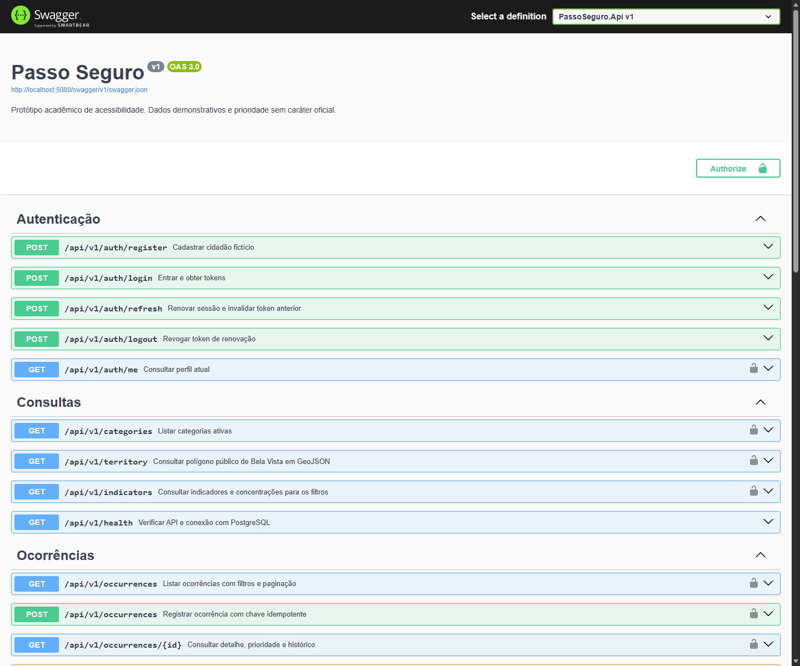
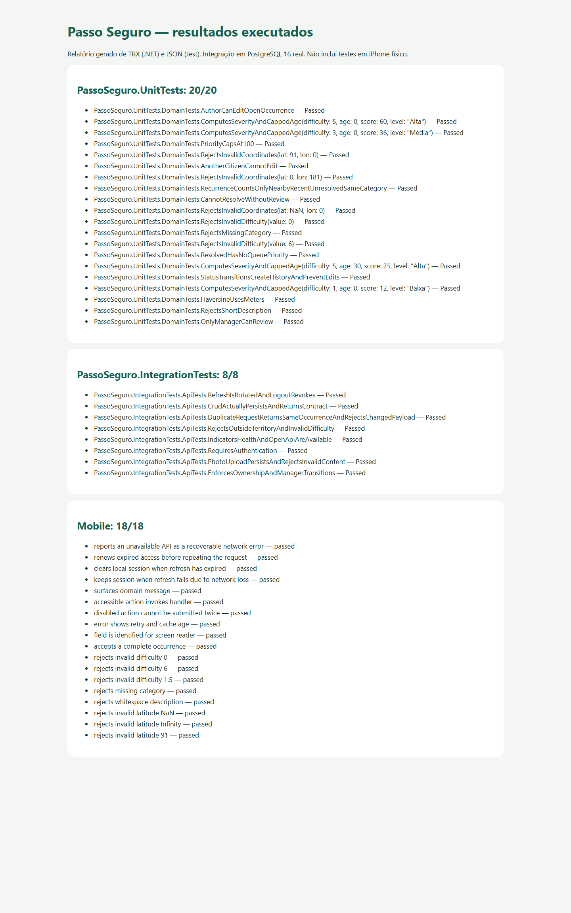

# Passo Seguro

## Sumário

- [Ficha da CitizenTech](#ficha-da-citizentech)
- [Integrantes e repositório](#integrantes-e-repositorio)
- [Evidências das telas do aplicativo](#evidencias-do-aplicativo)
- [Execução do projeto](#execucao-do-projeto)
  - [Backend e banco de dados](#backend-e-banco)
  - [Aplicativo no iPhone](#aplicativo-no-iphone)
  - [Parar e retomar](#parar-e-retomar)
- [Funcionalidades e interface](#funcionalidades-e-interface)
- [Arquitetura e persistência](#arquitetura-e-persistencia)
- [Regras de negócio e API](#regras-e-api)
- [Dados e fontes](#dados-e-fontes)
- [Testes e qualidade](#testes-e-qualidade)
- [Evidências técnicas](#evidencias-tecnicas)
- [Vídeo de demonstração](#video-de-demonstracao)
- [Entrega acadêmica](#entrega-academica)

<a id="ficha-da-citizentech"></a>

## Ficha da CitizenTech

| Campo | Definição |
|---|---|
| Território | Distrito Bela Vista, São Paulo/SP |
| Cidadão beneficiado | Pedestres, idosos e pessoas com deficiência ou mobilidade reduzida |
| Problema | Barreiras na circulação são pouco organizadas e dificultam compreender onde há maior necessidade de intervenção. |
| Solução | Registrar obstáculos, consultar mapa/lista, acompanhar andamento e visualizar prioridades e indicadores. |
| Ecossistema | Cidadão contribui; gestor demonstrativo acompanha; API organiza e persiste; app apresenta a jornada. |
| Impacto mensurável | Quantidade, distribuição, dificuldade e evolução das ocorrências, sem inferir resolução oficial. |
| ODS | 10: visibilidade de barreiras à inclusão; 11: informações sobre acessibilidade e mobilidade urbana. |
| Escopo desta entrega | Mobile, SOA e C#; IA, IoT e entregas das demais disciplinas excluídas por decisão da equipe. |

Protótipo acadêmico. Não existe integração oficial com a Prefeitura/CET nem garantia de atendimento. Use somente dados fictícios ou públicos.

<a id="integrantes-e-repositorio"></a>

## Integrantes e repositório

| Nome completo | RM |
|---|---|
| A preencher | A preencher |

**Repositório GitHub:** inserir a URL do projeto.

<a id="evidencias-do-aplicativo"></a>

## Evidências das telas do aplicativo

A tabela reúne as telas e variações da jornada do usuário. As imagens devem ser capturas reais do aplicativo no iPhone.

Os prints ainda não foram adicionados ao repositório. Salve-os em `docs/evidencias/mobile/` e substitua as células pendentes pelas imagens correspondentes. Os nomes de arquivo abaixo são sugestões; podem ser ajustados aos arquivos enviados.

| Descrição | Evidência (print da tela) |
|---|---|
| **Login:** entrada na conta com e-mail e senha e acesso à criação de conta. | _Adicionar print_ — `login.png` |
| **Login com erro:** mensagem de credenciais inválidas ou falha ao entrar. | _Adicionar print_ — `login-erro.png` |
| **Criar conta:** formulário com nome, e-mail, senha e confirmação de senha. | _Adicionar print_ — `criar-conta.png` |
| **Validação do cadastro:** mensagem para dados inválidos, senhas divergentes ou e-mail já cadastrado. | _Adicionar print_ — `criar-conta-validacao.png` |
| **Início:** visão geral, saudação, total de ocorrências e atalhos da jornada. | _Adicionar print_ — `inicio.png` |
| **Criar ocorrência — categoria e descrição:** seleção da categoria, descrição do obstáculo e dificuldade de circulação. | _Adicionar print_ — `criar-ocorrencia.png` |
| **Criar ocorrência — endereço:** preenchimento e busca do endereço para posicionar o marcador. | _Adicionar print_ — `ocorrencia-endereco.png` |
| **Criar ocorrência — localização atual:** uso do GPS para selecionar o ponto da ocorrência. | _Adicionar print_ — `ocorrencia-localizacao-atual.png` |
| **Criar ocorrência — seleção no mapa:** marcador do obstáculo e campos de latitude e longitude. | _Adicionar print_ — `ocorrencia-mapa.png` |
| **Criar ocorrência — fotografia:** imagem selecionada pela câmera ou galeria e opção de retirar a foto. | _Adicionar print_ — `ocorrencia-foto.png` |
| **Validação da ocorrência:** mensagem de campo inválido, ponto fora de Bela Vista ou permissão de localização negada. | _Adicionar print_ — `ocorrencia-validacao.png` |
| **Explorar — lista:** consulta dos obstáculos registrados, com prioridade, andamento e acesso aos detalhes. | _Adicionar print_ — `explorar-lista.png` |
| **Explorar — filtros:** opções horizontais de categoria, andamento, prioridade e dificuldade. | _Adicionar print_ — `explorar-filtros.png` |
| **Explorar — mapa:** distribuição das ocorrências da página consultada em marcadores. | _Adicionar print_ — `explorar-mapa.png` |
| **Consulta sem resultados:** estado de lista vazia para os filtros selecionados. | _Adicionar print_ — `consulta-vazia.png` |
| **Consulta com falha de conexão:** mensagem de erro e ação para tentar novamente. | _Adicionar print_ — `consulta-erro.png` |
| **Minhas ocorrências:** lista dos registros criados pela conta conectada. | _Adicionar print_ — `minhas-ocorrencias.png` |
| **Detalhe — aberta:** ocorrência em aberto, identificada em roxo, com informações e prioridade calculada. | _Adicionar print_ — `detalhe-aberta.png` |
| **Detalhe — em análise:** ocorrência em análise, identificada em amarelo. | _Adicionar print_ — `detalhe-em-analise.png` |
| **Detalhe — resolvida:** ocorrência resolvida, identificada em verde. | _Adicionar print_ — `detalhe-resolvida.png` |
| **Detalhe — histórico:** linha do tempo com as alterações de andamento e suas datas. | _Adicionar print_ — `detalhe-historico.png` |
| **Editar ocorrência:** formulário preenchido para atualização de uma ocorrência aberta do próprio usuário. | _Adicionar print_ — `editar-ocorrencia.png` |
| **Excluir ocorrência:** confirmação antes de remover o registro. | _Adicionar print_ — `excluir-ocorrencia.png` |
| **Gestão do andamento:** ações do gestor para iniciar análise, marcar resolução ou retornar a ocorrência para aberta. | _Adicionar print_ — `gestao-andamento.png` |
| **Indicadores — resumo e filtros:** total de registros e seleção horizontal do período de análise. | _Adicionar print_ — `indicadores-resumo.png` |
| **Indicadores — distribuição:** categorias, andamentos e prioridades das ocorrências. | _Adicionar print_ — `indicadores-distribuicao.png` |
| **Indicadores — evolução e concentração:** registros por dia e concentrações regionais. | _Adicionar print_ — `indicadores-evolucao.png` |
| **Rascunhos:** registros salvos no aparelho, com opções para continuar ou excluir. | _Adicionar print_ — `rascunhos.png` |
| **Rascunhos vazios:** mensagem exibida quando não há registros locais salvos. | _Adicionar print_ — `rascunhos-vazios.png` |
| **Consulta offline:** dados recuperados do cache, com indicação da última atualização. | _Adicionar print_ — `consulta-offline.png` |
| **Perfil:** identificação da conta, papel de acesso, informações do app e acesso aos rascunhos. | _Adicionar print_ — `perfil.png` |
| **Sair da conta:** confirmação de saída e aviso sobre a limpeza de cache e rascunhos locais. | _Adicionar print_ — `sair-da-conta.png` |

Para exibir um print na segunda coluna, substitua a célula por uma imagem com largura ajustada, por exemplo:

```html

```

Se uma tela precisar de mais de uma captura, coloque as imagens na mesma célula, separadas por `<br>`, ou acrescente uma linha com a descrição da variação.

<a id="execucao-do-projeto"></a>

## Execução do projeto

<a id="backend-e-banco"></a>

### Backend e banco de dados no Windows

Pré-requisitos: Docker Desktop com engine Linux ativo, Node **22 LTS**, npm e Expo Go compatível com SDK 54. .NET SDK 10 é necessário para desenvolver/testar o backend fora do container.

Na raiz `PassoSeguro`:

```powershell
./scripts/setup.ps1
```

O script cria `.env` com senhas aleatórias locais se não existir, sobe PostgreSQL **16**, compila a API, aplica migrações e seed e inicia a API. Não sobrescreve sua configuração existente. Alternativamente, copie `.env.example` para `.env`, substitua os valores e execute:

```powershell
docker compose up -d db --wait
docker compose build api
docker compose run --rm api --migrate
docker compose up -d api
```

- Swagger: [http://localhost:5080/swagger](http://localhost:5080/swagger).
- OpenAPI: [http://localhost:5080/swagger/v1/swagger.json](http://localhost:5080/swagger/v1/swagger.json).
- Saúde: [http://localhost:5080/api/v1/health](http://localhost:5080/api/v1/health).
- Banco no host: `127.0.0.1:5436`; entre containers: `db:5432`.
- Contas: `cidadao@passoseguro.test` e `gestor@passoseguro.test`; senha: valor de `DEMO_PASSWORD` no `.env` local.

O seed não reseta senhas de um banco já inicializado. Alterar `DEMO_PASSWORD` após o primeiro seed não altera contas existentes.

<a id="aplicativo-no-iphone"></a>

### Aplicativo no iPhone

```powershell
cd mobile
npm ci
Copy-Item .env.example .env
# Edite EXPO_PUBLIC_API_URL com o IPv4 do computador, por exemplo:
# EXPO_PUBLIC_API_URL=http://192.168.0.10:5080/api/v1
npx expo start
```

Conecte computador e iPhone à mesma rede e leia o QR code com o iPhone. `localhost` no aparelho aponta para o próprio iPhone; use o IP do computador. Abra `http://IP-DO-PC:5080/api/v1/health` no Safari para verificar a conectividade. Permita acesso à rede local quando solicitado e verifique firewall/rede Wi-Fi sem isolamento de clientes. O túnel do Metro não publica a API automaticamente.

O pacote `expo` está fixado em **54.0.0**, conforme solicitado. `expo.install.exclude` preserva esse requisito ao verificar compatibilidade; não atualizar o SDK automaticamente.

<a id="parar-e-retomar"></a>

### Parar e retomar

```powershell
docker compose stop
docker compose up -d
```

O volume nomeado preserva o banco. Não use remoção de volumes para reiniciar a demonstração. Migrações só são aplicadas pelo comando explícito `--migrate`.

<a id="funcionalidades-e-interface"></a>

## Funcionalidades e interface

O app usa tema escuro com detalhes ciano/violeta, transições suaves e respeito à preferência de reduzir movimento do aparelho. Os filtros de Explorar, Minhas e Indicadores, assim como as opções do formulário, ficam em faixas horizontais deslizáveis.

No registro, informe opcionalmente um endereço (até 300 caracteres) e use **Localizar endereço** para posicionar o marcador. Quando houver mais de um resultado, selecione um e confira o mapa. **Usar localização atual** pede permissão e usa o GPS; um endereço anterior é removido para não associá-lo ao novo ponto. A geocodificação utiliza os serviços nativos do aparelho, pode exigir conexão e deve ser validada no iPhone. A restrição do protótipo a Bela Vista continua aplicada pela API.

O endereço é salvo no PostgreSQL, recuperado na edição/detalhe e preservado nos rascunhos. A migração `AddOccurrenceAddress` adiciona uma coluna opcional, sem excluir registros existentes.

Andamentos possíveis: **Aberta** (roxo), **Em análise** (amarelo), **Resolvida** (verde). O fluxo é Aberta → Em análise → Resolvida, com retorno Em análise → Aberta. As cores aparecem nos badges e na linha do tempo; texto e ícones também identificam o estado independentemente da cor.

<a id="arquitetura-e-persistencia"></a>

## Arquitetura e persistência

- `Domain`: entidades encapsuladas, invariantes, transições e algoritmo de prioridade.
- `Application`: DTOs validados, interfaces e casos de uso; não serializa entidades de persistência.
- `Infrastructure`: EF Core/Npgsql, chaves estrangeiras, consultas LINQ assíncronas, migrações e seed.
- `Api`: REST, JWT, DI, autorização, erros e OpenAPI.
- `mobile`: Expo Router, componentes reutilizáveis, tema central, serviços HTTP, SecureStore e SQLite.

O PostgreSQL é a fonte de verdade compartilhada. SQLite foi escolhido para recuperar consultas recentes e rascunhos sem rede, com acesso isolado em `src/storage.ts`. Credenciais não ficam no SQLite: sessão em SecureStore. O logout remove os registros locais da conta. A foto de uma consulta exige conexão; fotos de rascunho são copiadas para armazenamento persistente do app.

O protótipo usa uma base pequena: a seleção inicial é lida por EF Core e agregada em memória nos casos de uso, para calcular recorrência global de modo consistente. Não é uma arquitetura para volume municipal; paginação e filtros fazem parte do contrato, e a evolução para consultas espaciais deve preservar as regras.

<a id="regras-e-api"></a>

## Regras de negócio e API

- Cidadãos alteram/excluem apenas suas próprias ocorrências abertas.
- Gestores mudam `Open → InReview → Resolved` ou `InReview → Open`.
- Mudanças ficam no histórico. Resolvidas permanecem nas consultas, fora da fila de prioridade.
- Latitude/longitude devem estar dentro do polígono oficial de Bela Vista.
- Descrição: 10–2000 caracteres; dificuldade: inteiro de 1 a 5; categoria ativa obrigatória.
- Fotos opcionais JPEG/PNG de até 5 MB; envio separado permite recuperar falha sem perder a ocorrência.
- Cadastro cria apenas cidadão. Gestor é provisionado pelo seed.
- JWT: 15 minutos; refresh: 7 dias, armazenado como hash, rotacionado e revogável. Logout revoga refresh; um JWT emitido expira ao fim da validade.

Prioridade: `dificuldade × 12 + min(semelhantes × 5, 25) + min(dias completos em aberto, 15)`. Semelhantes: mesma categoria, até 200 m, últimos 30 dias, não resolvidas, excluindo a própria. Baixa <35; média <60; alta <80; crítica >=80. Tempo em dias completos de 24h; cálculo em UTC. Resultado inclui a explicação dos pontos.

| Método | Rota base `/api/v1` | Uso |
|---|---|---|
| POST | `/auth/register`, `/auth/login`, `/auth/refresh`, `/auth/logout` | Sessão |
| GET | `/auth/me` | Perfil atual |
| GET | `/categories`, `/territory` | Catálogo e GeoJSON |
| GET / POST | `/occurrences` | Consultar/criar |
| GET / PUT / DELETE | `/occurrences/{id}` | Detalhar/editar/excluir |
| PATCH | `/occurrences/{id}/status` | Andamento do gestor |
| GET | `/occurrences/{id}/history` | Histórico |
| GET / PUT / DELETE | `/occurrences/{id}/photo` | Foto |
| GET | `/indicators` | Agregados |
| GET | `/health` | API/banco |

Filtros: `categoryId`, `status`, `difficulty`, `priority`, `from`, `to`, `mine`; paginação `page` e `pageSize` (máximo 100), ordenação `sort=recent|priority`. Indicadores agregam todo o resultado dos filtros, sem limitar à página. Série temporal usa UTC. As concentrações usam células aproximadas de 200 m.

Criação requer header `Idempotency-Key` com UUID. Repetir a mesma chave e conteúdo retorna a mesma ocorrência; reutilizar com conteúdo diferente gera `409`. Bearer JWT no header `Authorization`; Swagger oferece **Authorize**. Erros de validação usam `400`; regras de domínio `422`; sem sessão `401`; sem permissão `403`; ausente `404`; conflito `409`.

O OpenAPI documenta `201` e o header `Location` na criação; `204` sem corpo nas exclusões, logout e envio da foto; `503` quando a verificação de saúde não consegue acessar o banco. A consulta da foto retorna bytes `image/jpeg` ou `image/png`. Há exemplos fictícios para os DTOs, modelos de erro e respostas consolidadas; o exemplo GeoJSON usa o polígono público versionado.

<a id="dados-e-fontes"></a>

## Dados e fontes

Ocorrências, usuários, categorias e fotos de teste são **simulados**, sem dados pessoais reais. O limite geográfico é público: camada `geoportal:distrito_municipal`, feição `distrito_municipal.8583447`, GeoSampa/Prefeitura de São Paulo, obtida em 11/11/2026 via WFS, com atualização informada de 27/10/2026. Fonte original informada: GEOGSG; escala 1:5000. O GeoJSON original e seus metadados estão versionados na infraestrutura.

- [GeoSampa](https://novogeosampa.prefeitura.sp.gov.br/)
- [Tutorial oficial dos serviços WFS](https://geoinfo-smdu.github.io/tutorial-GeoSampa/)
- [Serviço WFS](https://wfs.geosampa.prefeitura.sp.gov.br/geoserver/geoportal/wfs)

A resposta WFS consultada não informa licença específica; preservar a atribuição e consultar os termos municipais antes de redistribuição para outro uso. O app não consulta esse serviço em tempo de execução.

<a id="testes-e-qualidade"></a>

## Testes e qualidade

Com Docker ativo, a partir da raiz:

```powershell
dotnet restore
npm --prefix mobile ci
npm run test:all
npm run check
```

A integração cria e remove seu próprio container PostgreSQL 16, com nome e senha aleatórios e porta dinâmica. Não utiliza nem apaga o volume da demonstração. Testes cobrem domínio, CRUD persistido, autorização, idempotência, filtros, status/corpo HTTP, fotos, sessão e OpenAPI; mobile cobre validações e componentes acessíveis. Validação física continua necessária para GPS, câmera, mapas, SQLite nativo e VoiceOver.

Consulte [matriz de requisitos](docs/REQUISITOS.md) e [validação e pendências](docs/VALIDACAO.md). Não confundir implementação com requisito fisicamente verificado.

<a id="evidencias-tecnicas"></a>

## Evidências técnicas



- [Smoke HTTP e persistência após reinício](docs/evidencias/api-smoke.json).
- [Relatório dos testes executados](docs/evidencias/test-results.html), gerado dos arquivos TRX e JSON reais.
- [Resultados Jest](docs/evidencias/mobile-tests.json).



As capturas do aplicativo devem ser inseridas na [tabela de evidências das telas](#evidencias-do-aplicativo). O vídeo possui uma [seção própria](#video-de-demonstracao). Imagens e links ainda não adicionados estão identificados como pendentes.

Auditoria de dependências: permanecem alertas transitivos do SDK 54, incluindo um alto em `image-size` do Metro. Detalhes e limites estão em [VALIDACAO.md](docs/VALIDACAO.md); não foi feito upgrade forçado do SDK exigido.

<a id="video-de-demonstracao"></a>

## Vídeo de demonstração

**Link do vídeo Mobile:** a inserir após a publicação no YouTube como não listado.

O vídeo deve ter até **3 minutos** e mostrar o aplicativo em execução, a jornada principal completa e os dados sendo **salvos e recuperados**. O [roteiro sugerido](docs/ROTEIRO.md) orienta a gravação.

<a id="entrega-academica"></a>

## Entrega acadêmica

Prazo dos documentos: **19/11/2026 às 23h55**, inclusive commits. Antes de enviar: completar integrantes/RMs e URL pública, capturar telas no aparelho, gravar vídeo não listado até 3 minutos e confirmar acesso do professor. Roteiro em [docs/ROTEIRO.md](docs/ROTEIRO.md). Submissão é feita pela equipe.
