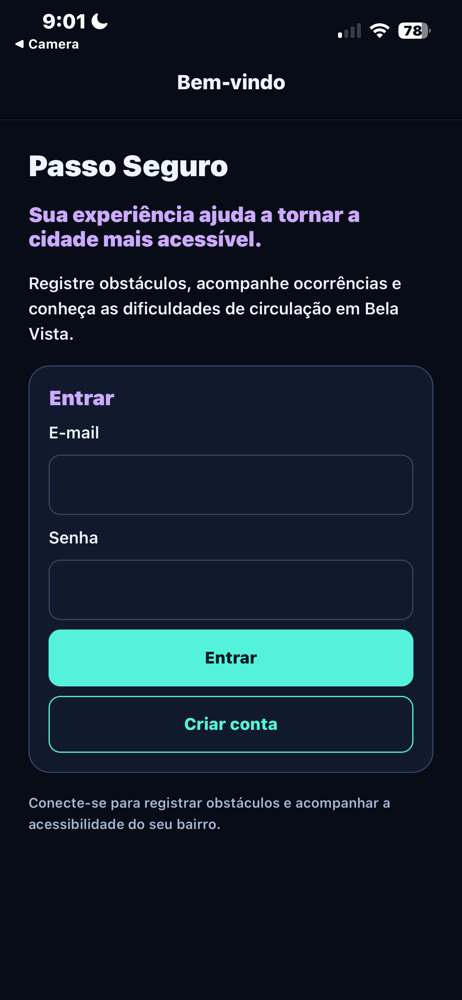
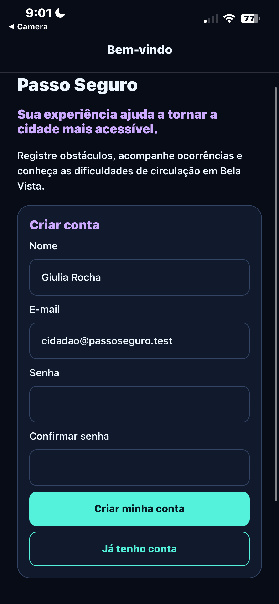
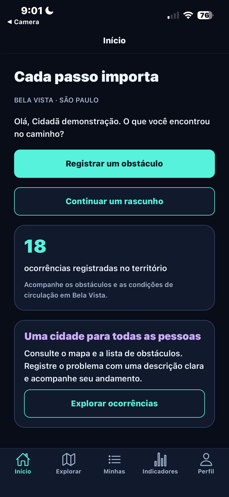
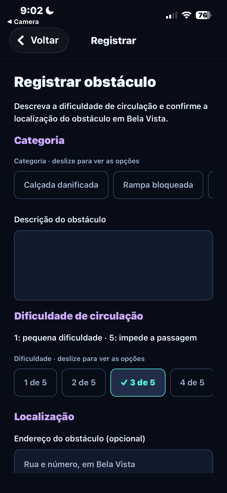
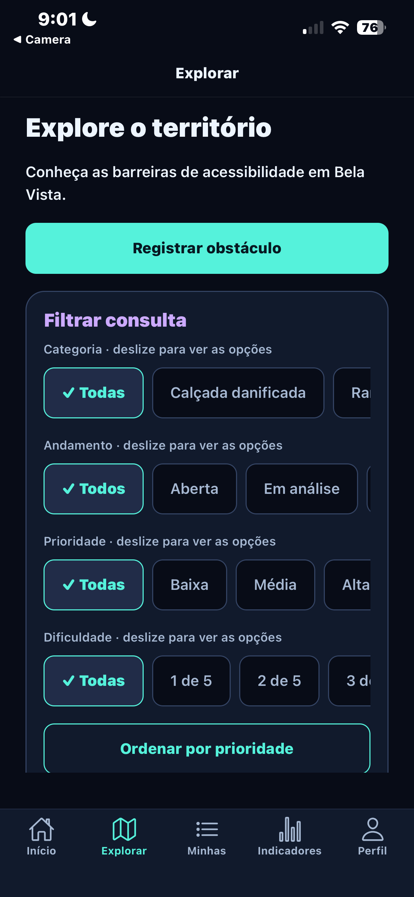
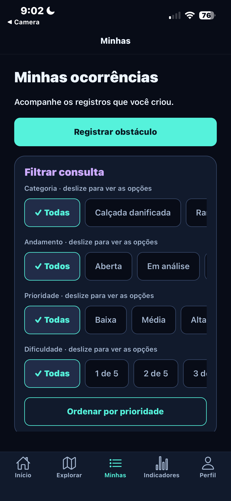
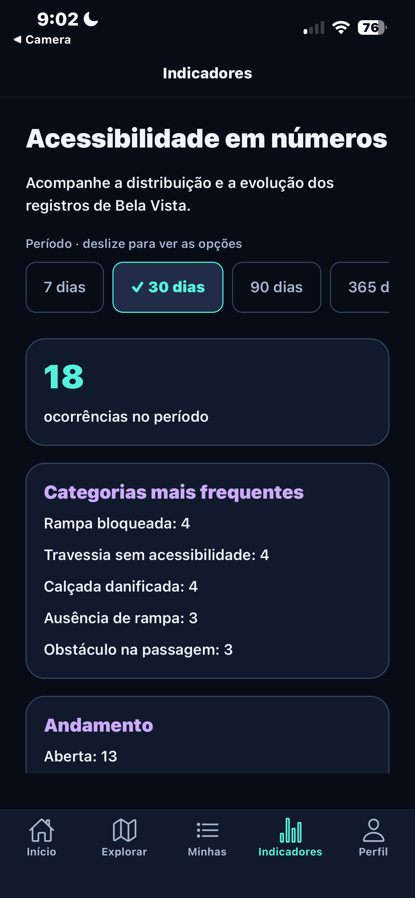
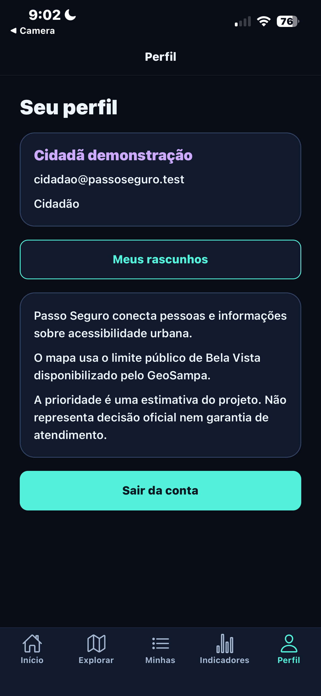
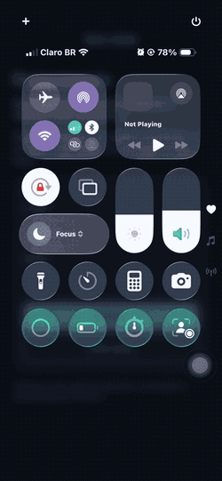

# Passo Seguro

Aplicativo de acessibilidade urbana para registrar obstáculos, acompanhar ocorrências e analisar as condições de circulação de pedestres em Bela Vista, São Paulo.

<a id="tecnologias"></a>

## Tecnologias

| Área | Tecnologias |
|---|---|
| Aplicativo | React Native 0.81.5, React 19.1, TypeScript 5.9 e Expo SDK 54.0.0 |
| Navegação e interface | Expo Router, React Native Maps e tema centralizado |
| Recursos do aparelho | Expo Location, Image Picker e File System |
| Persistência local | SQLite e SecureStore |
| Backend | C#, .NET 10 e ASP.NET Core Web API |
| Persistência do backend | Entity Framework Core 10 e Npgsql |
| Banco de dados | PostgreSQL 16 |
| Autenticação | JWT e refresh tokens |
| Documentação da API | OpenAPI e Swagger UI |
| Testes | xUnit, Jest e React Native Testing Library |
| Infraestrutura e integração contínua | Docker Compose e GitHub Actions |

## Sumário

- [Tecnologias](#tecnologias)
- [Ficha da CitizenTech](#ficha-da-citizentech)
- [Integrantes](#integrantes)
- [Funcionalidades](#funcionalidades)
- [Evidências do aplicativo](#evidencias-do-aplicativo)
- [Vídeo de demonstração](#video-de-demonstracao)
- [Execução](#execucao)
  - [Backend e banco de dados](#backend-e-banco)
  - [Aplicativo no iPhone](#aplicativo-no-iphone)
- [Arquitetura e persistência](#arquitetura-e-persistencia)
- [Regras de negócio e API](#regras-e-api)
- [Testes](#testes)
- [Evidências técnicas](#evidencias-tecnicas)
- [Dados e fontes](#dados-e-fontes)

<a id="ficha-da-citizentech"></a>

## Ficha da CitizenTech

| Campo | Descrição |
|---|---|
| Território | Distrito Bela Vista, São Paulo/SP |
| Público beneficiado | Pedestres, idosos e pessoas com deficiência ou mobilidade reduzida |
| Problema | Barreiras na circulação dificultam os deslocamentos e a identificação de áreas que precisam de melhorias. |
| Solução | Registro colaborativo de obstáculos, acompanhamento do andamento, mapa de ocorrências e indicadores de acessibilidade. |
| Participantes | Cidadãos registram e consultam ocorrências; gestores acompanham e atualizam seu andamento. |
| Indicadores de impacto | Quantidade, localização, dificuldade e evolução das ocorrências. |
| ODS | ODS 10 — Redução das desigualdades; ODS 11 — Cidades e comunidades sustentáveis. |

<a id="integrantes"></a>

## Integrantes

| Nome completo | RM |
|---|---|
| Giulia Rocha | 558084 |
| Gabriel Danius | 555747 |
| Caio Rossini | 555084 |
| Carlos Eduardo | 556785 |

**Repositório:** [Giulia-Rocha/passo-seguro](https://github.com/Giulia-Rocha/passo-seguro).

<a id="funcionalidades"></a>

## Funcionalidades

- Cadastro e autenticação de cidadãos, com controle de acesso por perfil.
- Registro de ocorrências com categoria, descrição, dificuldade, endereço, localização e fotografia opcional.
- Busca por endereço, localização atual por GPS e seleção de ponto no mapa.
- Consulta em lista e mapa, com filtros, ordenação e paginação.
- Edição e exclusão de ocorrências abertas pelo próprio autor.
- Acompanhamento por status e histórico de atualizações.
- Indicadores por categoria, andamento, prioridade, período e concentração regional.
- Rascunhos e cache local para consulta sem conexão.
- Tema escuro, filtros horizontais, identificação textual dos status e suporte à redução de movimento.

O andamento é identificado por **Aberta** (roxo), **Em análise** (amarelo) e **Resolvida** (verde).

<a id="evidencias-do-aplicativo"></a>

## Evidências do aplicativo

| Descrição | Evidência |
|---|---|
| **Login:** acesso com e-mail e senha. |  |
| **Criar conta:** formulário com nome, e-mail, senha e confirmação. |  |
| **Início:** visão geral das ocorrências e atalhos da jornada. |  |
| **Criar ocorrência:** categoria, descrição, dificuldade e localização do obstáculo. |  |
| **Explorar:** consulta das ocorrências, filtros, prioridades e andamento. |  |
| **Minhas ocorrências:** registros criados pela conta conectada. |  |
| **Indicadores:** totais e distribuição dos registros de acessibilidade. |  |
| **Perfil:** identificação da conta, papel de acesso e rascunhos. |  |
| **Demonstração da jornada:** fluxo principal do aplicativo. |  |

<a id="video-de-demonstracao"></a>

## Vídeo de demonstração

[Assistir à demonstração do Passo Seguro](https://drive.google.com/file/d/1Isq1JXK9dg9kmraQ2UU9V-GQSo6VwUDs/view?usp=sharing).

<a id="execucao"></a>

## Execução

**Pré-requisitos:** Docker Desktop com engine Linux ativo, Node.js 22 LTS, npm e Expo Go compatível com SDK 54. Para executar os testes do backend, instalar também o .NET SDK 10.

<a id="backend-e-banco"></a>

### Backend e banco de dados

Na raiz do repositório, execute no PowerShell:

```powershell
./scripts/setup.ps1
```

O script configura o ambiente local, inicia o PostgreSQL, compila a API e aplica as migrações e a carga inicial de dados. As configurações ficam no arquivo `.env`, a partir das variáveis descritas em `.env.example`.

<details>
<summary>Execução manual com Docker Compose</summary>

Copie `.env.example` para `.env`, configure as variáveis e execute:

```powershell
docker compose up -d db --wait
docker compose build api
docker compose run --rm api --migrate
docker compose up -d api
```

</details>

| Recurso | Endereço |
|---|---|
| Swagger UI | [http://localhost:5080/swagger](http://localhost:5080/swagger) |
| OpenAPI | [http://localhost:5080/swagger/v1/swagger.json](http://localhost:5080/swagger/v1/swagger.json) |
| Saúde da API | [http://localhost:5080/api/v1/health](http://localhost:5080/api/v1/health) |
| PostgreSQL no computador | `127.0.0.1:5436` |

**Contas de acesso:** `cidadao@passoseguro.test` e `gestor@passoseguro.test`. A senha inicial corresponde ao valor de `DEMO_PASSWORD` utilizado na primeira carga de dados. Também é possível criar uma conta pelo aplicativo.

<a id="aplicativo-no-iphone"></a>

### Aplicativo no iPhone

```powershell
cd mobile
npm ci
Copy-Item .env.example .env
```

No arquivo `mobile/.env`, configure o IPv4 do computador na rede local:

```dotenv
EXPO_PUBLIC_API_URL=http://192.168.0.10:5080/api/v1
```

Inicie o aplicativo:

```powershell
npx expo start
```

Com o iPhone e o computador conectados à mesma rede, leia o QR code pelo Expo Go. A API deve estar acessível pelo IP configurado, com a porta `5080` liberada para a rede local.

<a id="arquitetura-e-persistencia"></a>

## Arquitetura e persistência

| Camada | Responsabilidade |
|---|---|
| `Domain` | Entidades, invariantes, transições de status e cálculo de prioridade. |
| `Application` | Casos de uso, interfaces, DTOs e validação de entradas. |
| `Infrastructure` | EF Core, Npgsql, relacionamentos, migrações e carga inicial. |
| `Api` | Endpoints REST, autenticação, autorização, tratamento de erros e OpenAPI. |
| `mobile` | Navegação, componentes, tema, serviços HTTP e persistência local. |

O **PostgreSQL 16** centraliza os dados compartilhados e mantém a integridade dos relacionamentos. A estrutura é versionada por migrações EF Core, e os dados permanecem no volume Docker após reinícios.

O **SQLite** armazena rascunhos e consultas recentes, permitindo recuperar informações sem conexão. O acesso local está concentrado em uma camada própria. O **SecureStore** armazena a sessão de autenticação.

<a id="regras-e-api"></a>

## Regras de negócio e API

- Ocorrências devem possuir autor, categoria ativa, localização em Bela Vista, descrição de 10 a 2000 caracteres e dificuldade de 1 a 5.
- O endereço é opcional, com limite de 300 caracteres. A fotografia pode ser JPEG ou PNG, de até 5 MB.
- Somente o autor pode editar ou excluir uma ocorrência enquanto estiver aberta.
- Gestores podem executar as transições **Aberta → Em análise → Resolvida** e **Em análise → Aberta**. Cada alteração gera uma entrada no histórico.
- A criação utiliza uma chave de idempotência para evitar duplicação ao repetir um envio.
- A autenticação utiliza JWT e refresh tokens rotacionados e revogáveis.

### Priorização

A pontuação estima a prioridade a partir de dificuldade, recorrência e tempo em aberto:

```text
pontuação = dificuldade × 12 + min(semelhantes × 5, 25) + min(dias em aberto, 15)
```

São consideradas semelhantes as ocorrências da mesma categoria, não resolvidas, registradas nos últimos 30 dias e a até 200 metros, excluindo a própria ocorrência. As faixas são **Baixa** (<35), **Média** (35–59), **Alta** (60–79) e **Crítica** (≥80). Ocorrências resolvidas permanecem no histórico e nos indicadores, fora da fila de prioridade.

### Endpoints

Base: `/api/v1`. Os contratos, exemplos, parâmetros e respostas HTTP estão disponíveis no Swagger.

| Método | Rota | Operação |
|---|---|---|
| POST | `/auth/register`, `/auth/login`, `/auth/refresh`, `/auth/logout` | Cadastro e sessão |
| GET | `/auth/me` | Perfil conectado |
| GET | `/categories`, `/territory` | Categorias e território |
| GET / POST | `/occurrences` | Consulta e criação |
| GET / PUT / DELETE | `/occurrences/{id}` | Detalhe, edição e exclusão |
| PATCH | `/occurrences/{id}/status` | Atualização de andamento |
| GET | `/occurrences/{id}/history` | Histórico de status |
| GET / PUT / DELETE | `/occurrences/{id}/photo` | Fotografia da ocorrência |
| GET | `/indicators` | Indicadores agregados |
| GET | `/health` | Disponibilidade da API e do banco |

As consultas oferecem filtros por categoria, status, dificuldade, prioridade, período e autoria, com ordenação e paginação.

<a id="testes"></a>

## Testes

Os testes cobrem regras de domínio, persistência em PostgreSQL, contratos HTTP, autenticação, permissões, idempotência, cadastro, filtros e componentes acessíveis do aplicativo.

Com Docker ativo, execute na raiz:

```powershell
dotnet restore
npm --prefix mobile ci
npm run test:all
```

Para compilar a solução e verificar TypeScript e lint:

```powershell
npm run check
```

Os testes de integração utilizam um container PostgreSQL 16 independente do banco da aplicação.

<a id="evidencias-tecnicas"></a>

## Evidências técnicas

### Documentação da API


### Testes automatizados


- [Relatório de testes](docs/evidencias/test-results.html).
- [Resultados dos testes mobile](docs/evidencias/mobile-tests.json).
- [Verificação de CRUD e persistência após reinício](docs/evidencias/api-smoke.json).
- [Matriz de requisitos](docs/REQUISITOS.md).
- [Registro de apoio de IA](prompts.md).

<a id="dados-e-fontes"></a>

## Dados e fontes

A carga inicial utiliza dados simulados. O limite territorial de Bela Vista é proveniente do **GeoSampa — Prefeitura de São Paulo**, camada `geoportal:distrito_municipal`, com atualização informada de 27/10/2026 e escala 1:5000. O GeoJSON e seus metadados estão versionados no backend.

- [GeoSampa](https://novogeosampa.prefeitura.sp.gov.br/).
- [Serviço WFS](https://wfs.geosampa.prefeitura.sp.gov.br/geoserver/geoportal/wfs).
